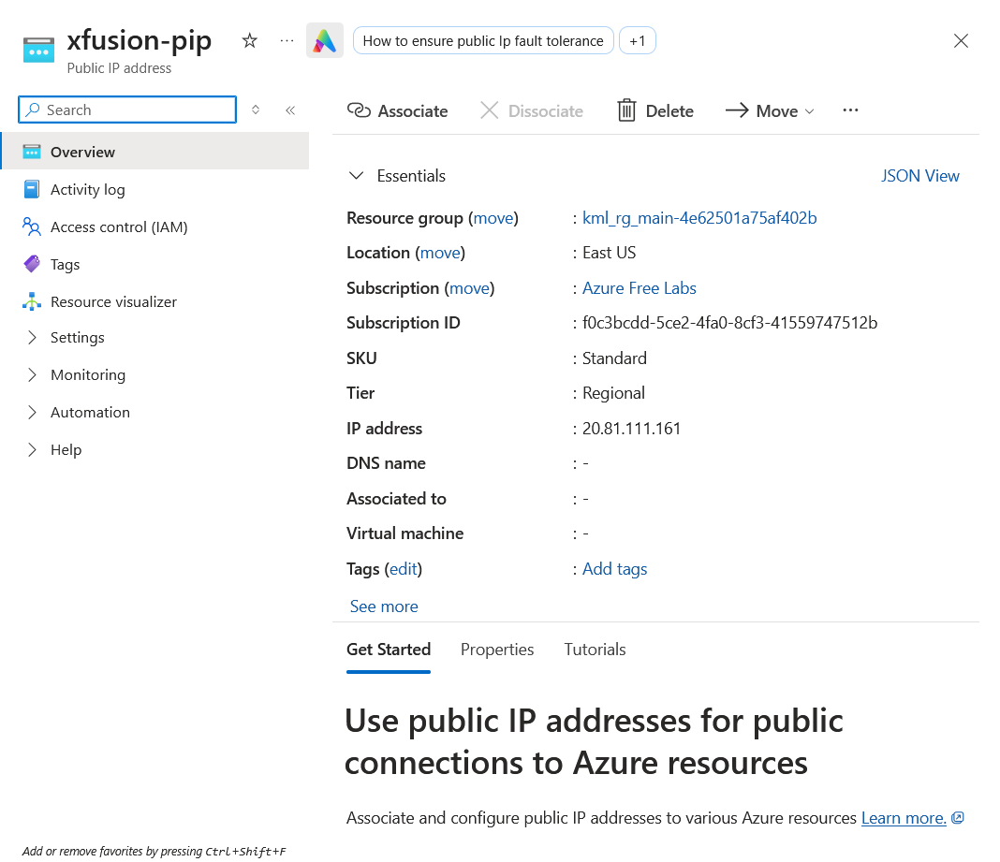
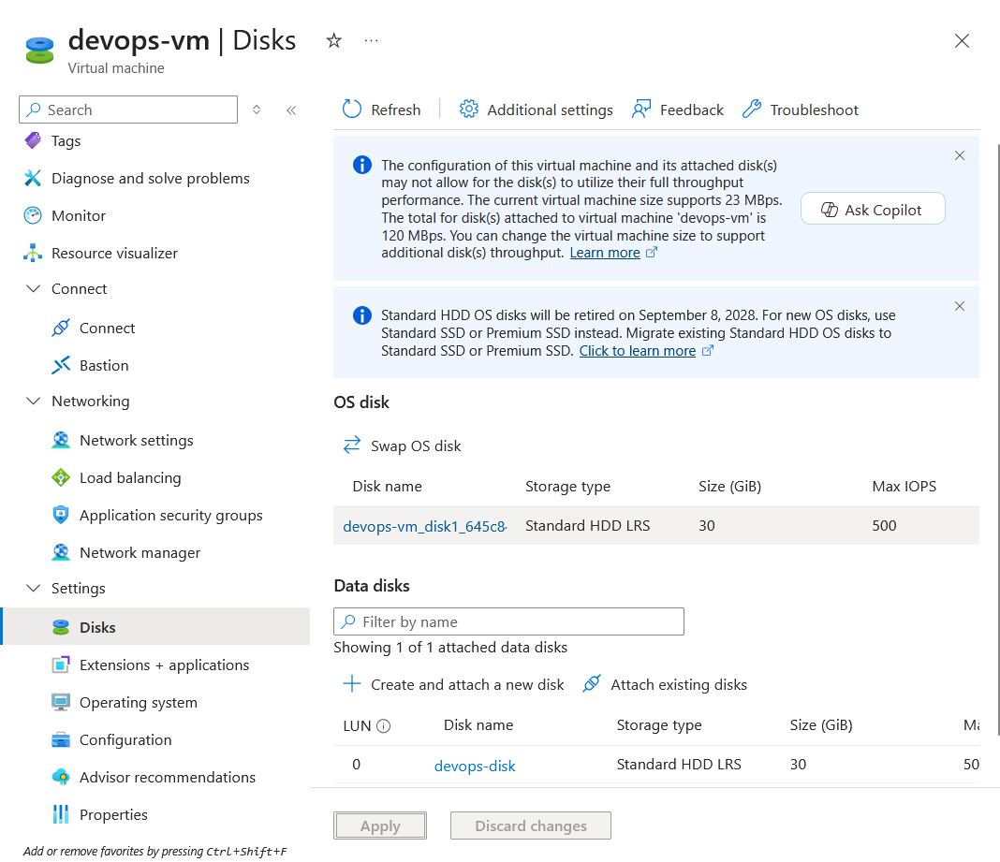

# Azure Virtual Network Setup Task

## Question / Problem Statement

The Nautilus DevOps team is strategically planning the migration of a portion of their infrastructure to the Azure cloud. They want to create a Virtual Network (VNet) with the following specifications:

- **Name:** `datacenter-vnet`
- **Region:** `eastus`
- **IPv4 CIDR:** `192.168.0.0/24`

---

## Azure Portal Walkthrough

## Question / Problem Statement

## Question / Problem Statement

The Nautilus DevOps team is strategizing the migration of a portion of their infrastructure to the Azure cloud. Recognizing the scale of this undertaking, they have opted to approach the migration in incremental steps rather than as a single massive transition. To achieve this, they have segmented large tasks into smaller, more manageable units. This granular approach enables the team to execute the migration in gradual phases, ensuring smoother implementation and minimizing disruption to ongoing operations. By breaking down the migration into smaller tasks, the Nautilus DevOps team can systematically progress through each stage, allowing for better control, risk mitigation, and optimization of resources throughout the migration process.

For this task, allocate a Public IP address, name it as xfusion-pip.

---

## Azure Portal Walkthrough

## Question / Problem Statement

An existing VM named devops-vm and a managed disk named devops-disk already exist in the East US region.

Attach the disk devops-disk to the VM devops-vm as a data disk.

Ensure the disk is attached to the VM devops-vm.

Make sure that the virtual machine initialization has been completed before submitting this task.

---

## Azure Portal Walkthrough

## Question / Problem Statement

The devops DevOps team is migrating services to Azure. They are breaking down tasks to ensure better control and optimization. You are tasked with attaching an existing network interface (NIC) to a virtual machine (VM).

An existing VM named devops-vm and a network interface named devops-nic already exist in the centralus region.

Attach the network interface devops-nic to the VM devops-vm.

Ensure the NIC's status is attached before submitting the task.

Make sure that the virtual machine initialization has been completed before submitting this task.

---

## Azure Portal Walkthrough
