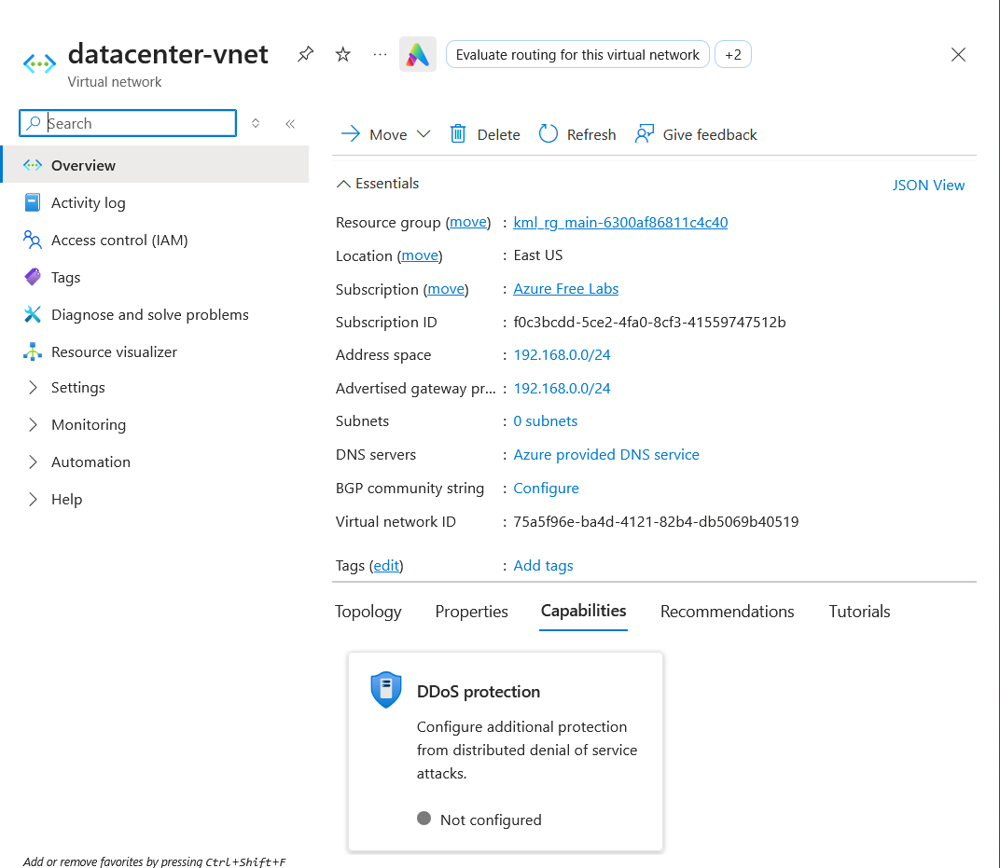
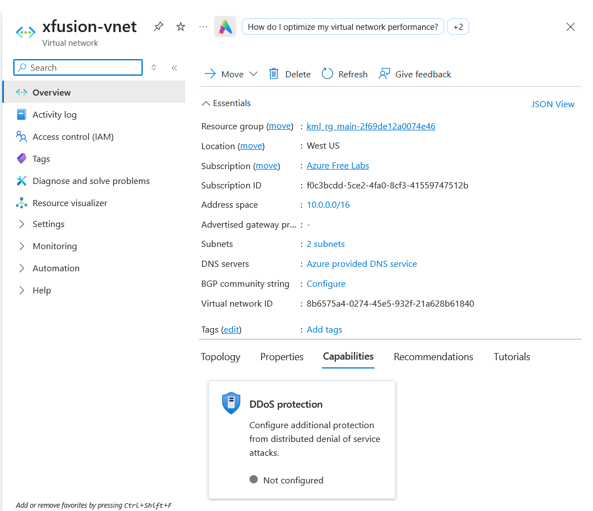

# Azure Virtual Network Setup Task

## Question / Problem Statement

The Nautilus DevOps team is strategically planning the migration of a portion of their infrastructure to the Azure cloud. They want to create a Virtual Network (VNet) with the following specifications:

- **Name:** `datacenter-vnet`
- **Region:** `eastus`
- **IPv4 CIDR:** `192.168.0.0/24`

---

## Azure Portal Walkthrough

## Question / Problem Statement

